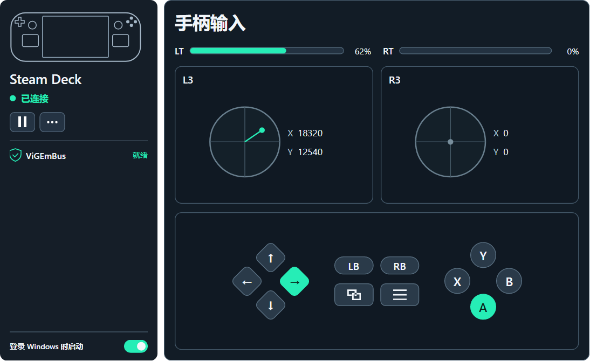
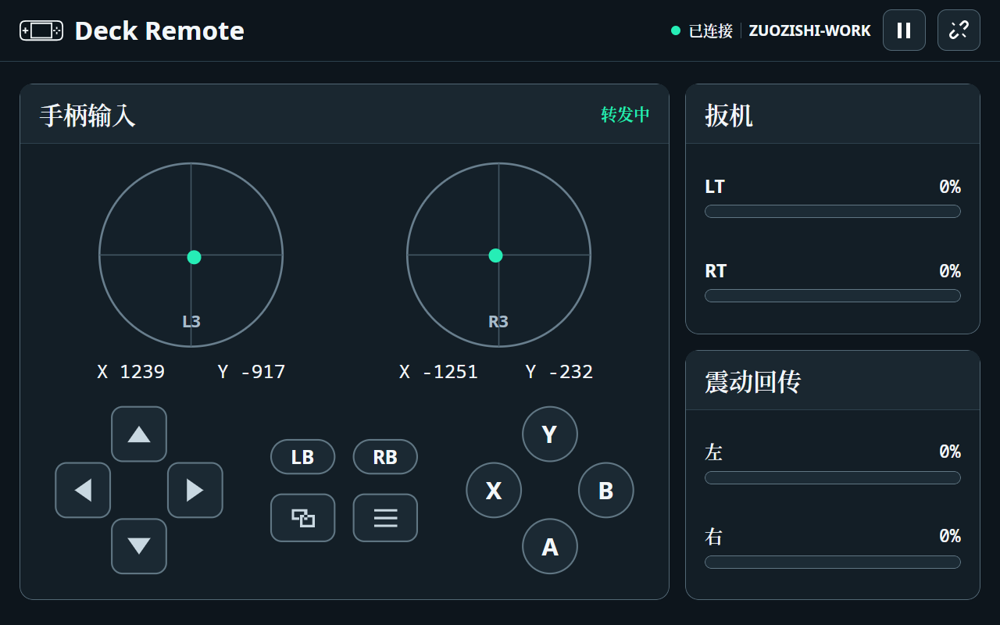

# Deck Remote

把 Steam Deck 的内置手柄作为 Windows 的 Xbox 360 手柄使用。两端通过同一 IPv4 局域网连接，支持自动发现、首次配对和自动重连。

## 界面预览

| Windows 接收端 | SteamOS 发送端 |
| --- | --- |
|  |  |

## 安装

从 [GitHub Releases](https://github.com/zuozishi/deck-remote/releases/latest) 下载 Windows x64 和 SteamOS 安装包。

1. 在 Windows x64 上运行 Windows 安装包，从开始菜单打开 **Deck Remote**。如果应用提示驱动不可用，从 [ViGEmBus 官方发布页](https://github.com/nefarius/ViGEmBus/releases/tag/v1.22.0) 安装驱动，并在应用内重新检测。安装程序需要管理员权限来写入程序目录和创建防火墙规则。日常启动使用普通用户权限。
2. 在 Steam Deck 切换到桌面模式，解压 SteamOS 包。在解压目录的 Konsole 中运行 **bash install.sh**。应用菜单会出现 **Deck Remote**。
3. 如需从游戏模式启动，在 Steam 桌面客户端将 **~/.local/opt/deck-remote/current/DeckRemote** 添加为非 Steam 游戏，关闭该条目的兼容性强制选项，并填写启动选项 **--game-mode**。返回游戏模式后，从 Steam 库打开它。

## 连接

在 PC 点击 **配对设备**。在 Steam Deck 选择自动发现的 PC，核对两端显示的 PC 与 Deck 验证码，再分别确认。PC 本地运行的 XInput 游戏即可读取手柄。之后只需打开两端客户端，Deck 会自动连接已配对的 PC。

使用 Greenlight 时，先运行 Windows 接收端，再打开 Greenlight。Windows 接收端启动后会注册一个 Xbox 360 手柄，首次连接和重连会沿用这只手柄。Deck 断开期间输入回中，退出 Windows 接收端时才会释放手柄。

两端升级到 **0.2.0** 后，支持手柄震动的 Windows 游戏会把左右马达强度传回 Deck。Deck 客户端失焦、暂停、断线或退出时会停止震动。

游戏模式用触屏操作应用。Steam 菜单、快捷访问菜单或其他应用获得焦点时，转发暂停。回到 Deck Remote 后自动恢复。如果菜单未报告焦点切换，可以触屏点击 **继续转发**。在桌面模式切换到其他应用时也会暂时停止转发。

Deck 端连接后会显示按键、摇杆、扳机和左右马达的实际回传强度。顶部的暂停按钮可暂时停止向 PC 转发并停止震动，再点继续按钮恢复。暂停期间仍可查看本地手柄输入。

两端升级到 **0.4.1** 后，Steam Deck 的右下背键 **R5** 会发送 Xbox 标志键（Guide）。Windows 端手柄预览会显示 Guide 高亮。连接旧版时可继续使用标准 Xbox 按键。

### 找不到 PC

- 确认两端在同一 IPv4 子网，且 Windows 接收端仍在托盘运行。
- 仅在可信局域网中，将 Windows 用于连接 Deck 的网络设为 **专用网络**。安装器的 TCP 和 UDP 入站规则都只允许本地子网使用端口 **39871**。
- 访客网络、无线客户端隔离或 VLAN 可能阻断广播。把两台设备接到同一个允许设备互访的网络。

## 构建与验证

使用 .NET 10 或更新版本的 SDK。Windows 安装包额外需要 NSIS 3.13 的编译器。

~~~powershell
dotnet build DeckRemote.slnx
dotnet run --project tests/DeckRemote.Checks
pwsh -File packaging/Build.ps1 -MakeNsis "C:\path\to\makensis.exe"
~~~

发行包输出到 **dist**。Windows 可用 **dotnet DeckRemote.dll --check-driver** 验证 XInput 状态与 ViGEmBus 的震动回调。SteamOS 可用 **./DeckRemote --check-input** 检查采集，或运行 **./DeckRemote --check-rumble** 试播左右两次短震动。

GitHub Actions 会在向 `main` 推送或提交目标为 `main` 的拉取请求时构建并运行自动检查。推送与 `Directory.Build.props` 版本一致的 `vX.Y.Z` 标签后，流水线会打包并发布 Release。

HID 报告格式参考 SDL 的 [Steam Deck 输入驱动](https://github.com/libsdl-org/SDL/blob/release-3.4.20/src/joystick/hidapi/SDL_hidapi_steamdeck.c) 和 [Valve 报告结构](https://github.com/libsdl-org/SDL/blob/release-3.4.20/src/joystick/hidapi/steam/controller_structs.h)。
